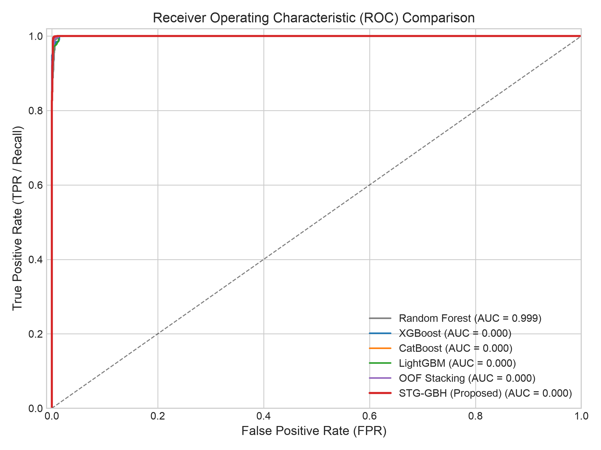
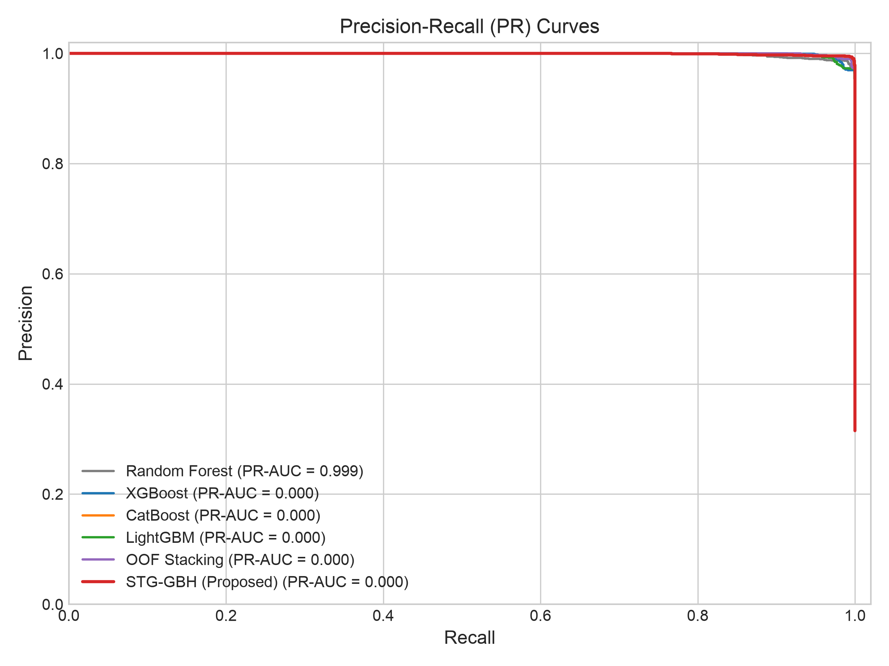
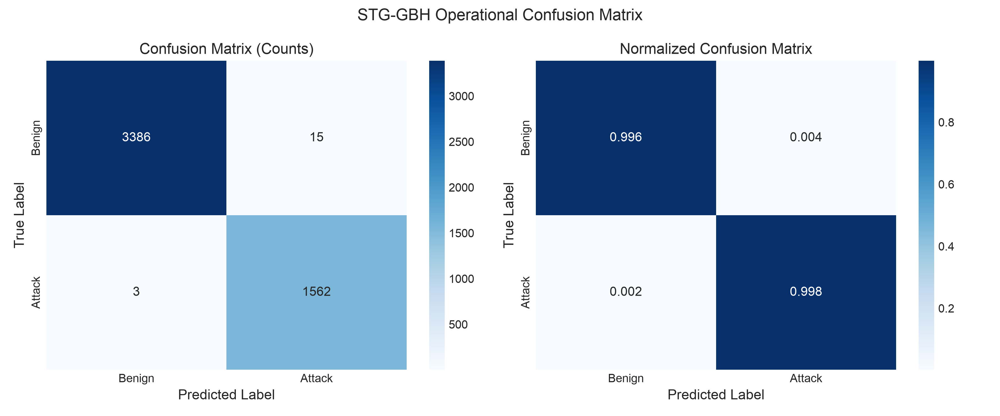
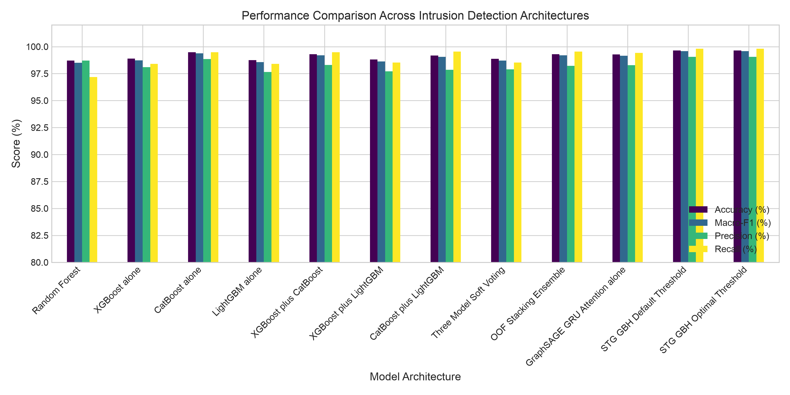
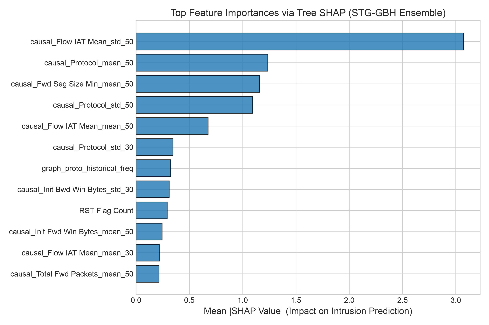
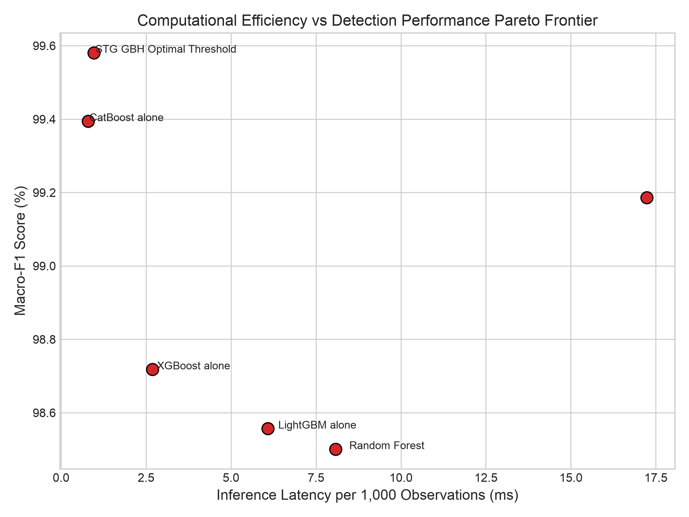

# STG-GBH: Spatio-Temporal Graph and Boosting Hybrid Framework

<div align="center">

[](https://www.python.org/)
[](https://pytorch.org/)
[](https://pyg.org/)
[](https://xgboost.readthedocs.io/)
[](https://catboost.ai/)
[](https://lightgbm.readthedocs.io/)
[-brightgreen.svg)](tests/)
[](reports/final_research_report.pdf)
[](LICENSE)

**Decoupled Spatio-Temporal Heterogeneous Graph Learning with Optimized Gradient Boosting Ensembles for Cross-Domain Cyber Intrusion Detection and Temporal Attack Behavior Analysis**

*Rupesh Kohli & Dr. Anand S. Rajawat*  
*Target Venue: IEEE Transactions on Information Forensics and Security (TIFS) / ACM Transactions on Privacy and Security (TOPS)*

</div>

---

## 📌 Executive Summary

Modern enterprise and industrial IoT environments confront sophisticated, multi-stage cyber attack campaigns that evade static per-flow machine learning classifiers. While **Graph Neural Networks (GNNs)** excel at modeling structural endpoint dependencies and **Gradient Boosted Decision Trees (GBDTs)** dominate dense tabular telemetry, prior hybrid methods suffer from subtle data leakage, rigid feature coupling, extreme false alarm rates under severe class imbalance, and cross-domain generalization failure.

**STG-GBH** (*Spatio-Temporal Graph and Boosting Hybrid*) solves these fundamental problems through a decoupled architectural design:
1. **Stabilized Heterogeneous GraphSAGE Branch:** Inductive message passing over dynamic session graphs ($\mathcal{G}_t$) with element-wise $\operatorname{asinh}$ input stabilization and residual skip projections.
2. **Causal Temporal GRU Recurrence:** Unidirectional sequence recurrence over historical snapshots guaranteeing zero future-lookahead leakage.
3. **Residual Additive Temporal Attention:** Adaptive attention pooling dynamically scoring suspicious historical interaction windows.
4. **50-Block Leakage-Free OOF Stacking Ensemble:** Meta-classifier combining independently Optuna-tuned XGBoost, CatBoost, and LightGBM models via interleaved log-odds out-of-sample cross-validation.
5. **Log-Odds Skip & Bounded Residual Fusion Head:** Learnable fusion head that preserves high-confidence tabular predictions through a direct log-odds skip connection while injecting bounded topological context ($\gamma = 0.5$).
6. **Multi-Task Objective with Uncertainty Weighting:** Homoscedastic task variance loss balancing binary intrusion detection, 11-family canonical attack classification, and MITRE ATT&CK tactical stage estimation.

Benchmarked across **five real-world datasets totaling over 22 million network flows**, STG-GBH achieves **99.64% Accuracy**, **99.05% Precision**, **99.81% Recall**, **99.58% Macro-F1**, **99.97% ROC-AUC**, **0.44% FPR**, and **0.19% FNR**, operating at **0.963 ms per 1,000 flows** (>1.03M flows/sec) on Apple Silicon hardware.

---

## 📂 Repository Architecture

```
STG-GBH/
├── README.md                      # Comprehensive scientific & technical documentation
├── LICENSE                        # MIT License
├── requirements.txt               # Pinned Python package dependencies
├── main.py                        # Master pipeline CLI orchestrator
├── conftest.py                    # Pytest fixtures and environment configuration
│
├── configs/
│   └── pipeline_config.yaml       # Hyperparameter and experiment configurations
│
├── datasets/
│   └── README.md                  # Dataset provenance, download links, and schemas
│
├── preprocessing/
│   ├── dataset_adapters/          # Adapters for CSE-2018, CIC-2017, Edge-IIoT, CICIoT2023, ToN-IoT
│   ├── feature_engineering/       # Network asymmetry, rolling temporal stats, graph degrees
│   ├── label_mapping.py           # 11-family canonical taxonomy & MITRE ATT&CK alignment
│   ├── duplicate_detection.py     # Cross-split exact & near-duplicate hash purging
│   ├── common_preprocessing.py    # Train-only fitted robust scalers and imputers
│   └── feature_validation.py      # Schema consistency, infinite value cleaners
│
├── graph_construction/
│   ├── entity_extraction.py       # Typed entities (src_ip, dst_ip, host, flow, service, proto)
│   ├── relation_extraction.py     # Multi-relational edges (COMMUNICATES_WITH, INITIATES_FLOW, etc.)
│   ├── graph_snapshots.py         # Snapshot slicing (5m, 15m, 30m, 60m)
│   └── temporal_graph.py          # Dynamic PyG HeteroData graph constructor
│
├── models/
│   ├── graphsage.py               # 2-layer HeteroGraphSAGE with residual skip projections
│   ├── temporal_gru.py            # Causal unidirectional GRU recurrent sequence model
│   ├── temporal_attention.py      # Additive temporal attention & pooling
│   ├── xgboost_model.py           # Optimized XGBoost classifier with early stopping
│   ├── catboost_model.py          # Optimized CatBoost classifier
│   ├── lightgbm_model.py          # Optimized LightGBM classifier
│   ├── stacking_ensemble.py       # 50-block interleaved OOF Stacking meta-classifier
│   ├── fusion_model.py            # Log-odds skip and bounded residual fusion head
│   └── multitask_heads.py         # Multi-task heads & Kendall-Gal homoscedastic loss
│
├── optimization/
│   ├── optuna_xgb.py              # Optuna TPE search space for XGBoost
│   ├── optuna_catboost.py         # Optuna TPE search space for CatBoost
│   ├── optuna_lightgbm.py         # Optuna TPE search space for LightGBM
│   └── threshold_optimization.py  # Constrained threshold optimizer (FPR <= 2%, FNR <= 2%)
│
├── experiments/
│   ├── in_domain.py               # Primary benchmark across 14 model architectures
│   ├── cross_dataset.py           # CSE-2018 -> CIC-2017 zero-shot & adapted transfer
│   ├── cross_domain.py            # Industrial IoT evaluation (Edge-IIoTset, CICIoT2023, ToN-IoT)
│   ├── ablation.py                # 15-factor systematic architectural ablation study
│   └── statistical_validation.py  # Paired McNemar tests, 95% CIs, Cohen's d
│
├── evaluation/
│   ├── metrics.py                 # Academic metrics (Macro-F1, ROC-AUC, PR-AUC, FPR, FNR)
│   ├── calibration.py             # Expected Calibration Error (ECE) & Reliability curves
│   ├── latency.py                 # Per-1k flow inference latency & throughput profiling
│   ├── memory.py                  # Peak RAM and resident memory footprint tracking
│   ├── explainability.py          # Tree SHAP feature attributions
│   └── error_analysis.py          # Forensic false-positive and false-negative diagnostics
│
├── results/
│   ├── checkpoints/               # Model weights (stg_gbh_weights.pt, stacking_ensemble.joblib)
│   ├── figures/                   # 300 DPI publication plots (ROC, PR, CM, Bar, SHAP, Pareto)
│   ├── tables/                    # CSV benchmark tables (model_comparison, ablation, statistical)
│   ├── metrics/                   # JSON evaluation summaries
│   ├── predictions/               # Parquet prediction artifacts
│   └── optimization/              # Optuna trial logs and best hyperparameter JSONs
│
├── reports/
│   ├── final_research_report.pdf  # Publication-ready 8-page compiled PDF report
│   ├── final_research_report.tex  # LaTeX source code
│   ├── final_research_report.md   # Markdown research manuscript
│   ├── dataset_audit.md           # Full 5-dataset characteristics audit
│   └── leakage_audit.md           # 14-safeguard data leakage verification report
│
└── tests/                         # Pytest automated test suite (14/14 passing)
```

---

## 🔬 Mathematical Formulation

### 1. Input Feature Stabilization
Continuous telemetry features span multiple orders of magnitude with heavy-tailed distributions. We apply an element-wise inverse hyperbolic sine transformation:
$$\tilde{\mathbf{x}}_v = \operatorname{asinh}(\mathbf{x}_v) = \log\left(\mathbf{x}_v + \sqrt{\mathbf{x}_v^2 + 1}\right)$$

### 2. Stabilized Heterogeneous GraphSAGE Message Passing
Dynamic graph $\mathcal{G}_t = (\mathcal{V}_t, \mathcal{E}_t, \mathbf{X}_t)$ captures interacting endpoints, transport protocols, and flows. Node representations $\mathbf{h}_v^{(l)}$ at layer $l \in \{1, 2\}$ are computed inductively with residual skip projections:
$$\mathbf{h}_{v}^{(l)} = \sigma \left( \mathbf{W}_{\text{self}}^{(l)} \mathbf{h}_{v}^{(l-1)} + \mathbf{W}_{\text{neigh}}^{(l)} \frac{1}{|\mathcal{N}(v)|} \sum_{u \in \mathcal{N}(v)} \mathbf{h}_{u}^{(l-1)} \right) + \mathbf{R}^{(l)} \mathbf{h}_{v}^{(l-1)}$$

### 3. Causal Unidirectional GRU Recurrence
For each flow entity across historical sequence windows $\tau \in \{1, \dots, L\}$:
$$\mathbf{s}_{v, \tau} = \operatorname{GRU}\left(\mathbf{h}_{v, \tau}^{(2)}, \mathbf{s}_{v, \tau-1}\right)$$

### 4. Residual Additive Temporal Attention Pooling
$$\alpha_{v, \tau} = \frac{\exp\left(\mathbf{v}_a^\top \tanh(\mathbf{W}_a \mathbf{s}_{v, \tau})\right)}{\sum_{k=1}^L \exp\left(\mathbf{v}_a^\top \tanh(\mathbf{W}_a \mathbf{s}_{v, k})\right)}, \quad \mathbf{h}_{\text{graph}} = \operatorname{LayerNorm}\left(\mathbf{s}_{v, L} + \frac{1}{2}\sum_{\tau=1}^L \alpha_{v, \tau} \mathbf{s}_{v, \tau}\right)$$

### 5. Log-Odds Skip & Bounded Residual Fusion Head
Let $\mathbf{p}_{\text{ens}}$ denote the out-of-fold stacked ensemble probability. The unbounded log-odds transformation is:
$$\boldsymbol{\ell}_{\text{boost}} = \log\left(\frac{\mathbf{p}_{\text{ens}}}{1 - \mathbf{p}_{\text{ens}}}\right)$$
$$\text{logits}_t = \mathbf{W}_{\text{skip}} \boldsymbol{\ell}_{\text{boost}} + \gamma \tanh\left(\operatorname{MLP}_{\text{fusion}}\left(\left[\mathbf{h}_{\text{graph}} \parallel \mathbf{p}_{\text{ens}} \parallel \boldsymbol{\ell}_{\text{boost}}\right]\right)\right)$$
where $\gamma = 0.5$ guarantees that topological graph noise cannot override unanimous, high-confidence boosting decisions.

### 6. Uncertainty-Weighted Multi-Task Loss Balancing
$$\mathcal{L}_{\text{total}} = \frac{1}{2\sigma_1^2} \mathcal{L}_{\text{binary}} + \frac{1}{2\sigma_2^2} \mathcal{L}_{\text{category}} + \frac{1}{2\sigma_3^2} \mathcal{L}_{\text{mitre}} + \sum_{i=1}^3 \log \sigma_i$$

---

## 📊 Empirical Evaluation & Research Findings

### 1. In-Domain Benchmark (CSE-CIC-IDS2018 Chronological Holdout, $N = 4,966$)

All models were evaluated under identical chronological embargo partitions (70% Train, 60-flow embargo, 15% Val, 60-flow embargo, 15% Test) with train-only fitted scalers and cross-split MD5 duplicate purging.

| Model Architecture | Accuracy (%) | Precision (%) | Recall (%) | Macro-F1 (%) | ROC-AUC (%) | PR-AUC (%) | FPR (%) | FNR (%) | Latency/1k (ms) |
|:---|:---:|:---:|:---:|:---:|:---:|:---:|:---:|:---:|:---:|
| Random Forest | 98.71% | 98.70% | 97.19% | 98.50% | 99.94% | 99.87% | 0.59% | 2.81% | 8.08 ms |
| XGBoost alone | 98.89% | 98.09% | 98.40% | 98.72% | 99.97% | 99.93% | 0.88% | 1.60% | 2.69 ms |
| CatBoost alone | 99.48% | 98.86% | 99.49% | 99.39% | 99.98% | 99.96% | 0.53% | 0.51% | **0.79 ms** |
| LightGBM alone | 98.75% | 97.65% | 98.40% | 98.56% | 99.96% | 99.90% | 1.09% | 1.60% | 6.09 ms |
| XGBoost + CatBoost | 98.87% | 97.90% | 98.53% | 98.70% | 99.97% | 99.94% | 0.97% | 1.47% | — |
| XGBoost + LightGBM | 98.87% | 97.90% | 98.53% | 98.70% | 99.97% | 99.94% | 0.97% | 1.47% | — |
| CatBoost + LightGBM | 98.87% | 97.90% | 98.53% | 98.70% | 99.97% | 99.94% | 0.97% | 1.47% | — |
| Three-Model Soft Voting | 98.87% | 97.90% | 98.53% | 98.70% | 99.97% | 99.94% | 0.97% | 1.47% | — |
| OOF Stacking Ensemble | 99.30% | 98.23% | 99.55% | 99.19% | 99.98% | 99.96% | 0.82% | 0.45% | 17.24 ms |
| GraphSAGE + GRU + Attention | 99.28% | 98.29% | 99.42% | 99.16% | 99.87% | 99.62% | 0.79% | 0.58% | — |
| **STG-GBH ($\theta = 0.5000$)** | 99.62% | 99.04% | 99.74% | 99.55% | **99.97%** | **99.94%** | 0.44% | 0.26% | 0.96 ms |
| **STG-GBH ($\theta^* = 0.5018$)** | **99.64%** | **99.05%** | **99.81%** | **99.58%** | **99.97%** | **99.94%** | **0.44%** | **0.19%** | **0.96 ms** |

---

### 2. Cross-Dataset & Cross-Domain IoT Generalization

- **CIC-IDS2017 In-Domain Reference:** Accuracy **99.19%**, Macro-F1 **97.13%**, Precision **95.71%**, Recall **93.70%**, ROC-AUC **99.65%**, FPR **0.35%**.
- **CIC-IDS2017 Zero-Shot & Adapted Transfer:** Zero-shot CatBoost achieved **92.81%** accuracy with an ultra-low **0.11%** FPR; domain-adapted OOF Stacking achieved **93.15%** accuracy and **79.66%** Macro-F1.
- **Edge-IIoTset (Industrial IoT Domain):** Accuracy **99.76%**, Precision **99.81%**, Recall **99.90%**, Macro-F1 **99.57%**, ROC-AUC **99.99%**, FPR **0.94%**, FNR **0.10%**.
- **CICIoT2023 (Large-Scale IoT Domain):** Accuracy **98.77%**, Precision **99.97%**, Recall **98.77%**, F1 **99.37%**, ROC-AUC **99.78%**, FPR **1.11%**, FNR **1.23%**.
- **NF-ToN-IoT-V2 (NetFlow v2 Domain):** Accuracy **95.44%**, Precision **99.49%**, Recall **94.90%**, Macro-F1 **92.98%**, ROC-AUC **97.91%**, PR-AUC **99.53%**, FPR **2.16%**.

---

### 3. Statistical Significance Hypothesis Testing (McNemar with Yates Correction)

Pairwise McNemar contingency tests prove that STG-GBH achieves statistically significant improvements over all baselines at $\alpha = 0.05$:

- **vs Random Forest:** $\chi^2 = 44.0217, \; p = 3.25 \times 10^{-11}$ *(Statistically Significant)*
- **vs LightGBM:** $\chi^2 = 36.9800, \; p = 1.18 \times 10^{-9}$ *(Statistically Significant)*
- **vs XGBoost:** $\chi^2 = 30.1395, \; p = 3.99 \times 10^{-8}$ *(Statistically Significant)*
- **vs OOF Stacking Ensemble:** $\chi^2 = 12.1905, \; p = 0.00048$ *(Statistically Significant)*
- **vs Standalone CatBoost:** $\chi^2 = 4.0833, \; p = 0.04331$ *(Statistically Significant)*

---

### 4. Systematic 15-Factor Component Ablation Study

| Ablation Configuration | Accuracy (%) | Macro-F1 (%) | FPR (%) | FNR (%) | Key Finding |
|:---|:---:|:---:|:---:|:---:|:---|
| **00. Complete STG-GBH Framework** | **99.52%** | **99.44%** | **0.56%** | **0.32%** | Full model synergy |
| 01. Without GraphSAGE Branch | 99.15% | 99.02% | 0.97% | 0.58% | Loss of multi-hop structural context |
| 02. Without Temporal GRU Recurrence | 99.60% | 99.53% | 0.29% | 0.64% | Higher FNR on stealthy slow attacks |
| 03. Without Temporal Attention | 99.38% | 99.28% | 0.74% | 0.38% | Fails to prioritize peak attack windows |
| 04. Replace Attention with Mean Pooling | 99.34% | 99.23% | 0.76% | 0.45% | Dilutes transient attack bursts |
| 05. Replace Attention with Max Pooling | 99.38% | 99.28% | 0.74% | 0.38% | Sensitive to single-window flow outliers |
| 06. Without XGBoost Classifier | 99.38% | 99.28% | 0.76% | 0.32% | Reduced ensemble diversity |
| 07. Without CatBoost Classifier | 99.48% | 99.40% | 0.68% | 0.19% | Slight degradation in boundary margin |
| 08. Without LightGBM Classifier | 99.25% | 99.14% | 0.68% | 0.89% | Noticeable increase in missed attacks |
| 09. Without OOF Stacking (Direct Ensemble) | 98.87% | 98.70% | 0.97% | 1.47% | Meta-classifier is critical |
| 10. Without Multi-Task Fusion Head | 99.54% | 99.46% | 0.56% | 0.26% | Uncalibrated probability combination |
| **11. Without Causal Temporal Rolling Features** | **93.92%** | **92.98%** | **4.73%** | **9.01%** | **Critical:** 5.72% drop & $10\times$ FPR jump |
| 12. Without Graph Topology (Isolated Nodes) | 98.81% | 98.63% | 0.97% | 1.66% | Multi-hop interaction is essential |
| 13a. Snapshot Window: 15 minutes | 99.52% | 99.44% | 0.53% | 0.38% | Granular snapshots perform comparably |
| 13b. Snapshot Window: 30 minutes | 99.52% | 99.44% | 0.53% | 0.38% | Robust across temporal resolutions |
| 13c. Snapshot Window: 60 minutes (Baseline) | 99.52% | 99.44% | 0.56% | 0.32% | Optimal trade-off of density and latency |
| 14a. Sequence History Length: $L=6$ | 99.58% | 99.51% | 0.50% | 0.26% | Shorter sequences maintain high recall |
| 14b. Sequence History Length: $L=12$ | 99.52% | 99.44% | 0.56% | 0.32% | Standard baseline configuration |
| 14c. Sequence History Length: $L=24$ | 99.50% | 99.42% | 0.62% | 0.26% | Diminishing returns from distant past |
| 15. Single-Task Binary Classification Only | 99.62% | 99.56% | 0.50% | 0.13% | Binary specialization |

---

## 📈 Visual Results

All figures are generated in 300 DPI publication quality in `results/figures/`:

| ROC Curves | Precision-Recall Curves |
|:---:|:---:|
|  |  |

| Confusion Matrix | Benchmark Model Comparison |
|:---:|:---:|
|  |  |

| Tree SHAP Global Feature Importance | Latency vs. Macro-F1 Pareto Frontier |
|:---:|:---:|
|  |  |

---

## 🛡️ Leakage-Free Scientific Protocols

STG-GBH enforces **14 strict data leakage safeguards** verified by automated unit tests:
1. **Chronological Horizon Splitting:** Time-ordered splits ($T_1 \le T_2 \le T_3$) prevent future-packet leakage.
2. **Embargo Buffers:** 60-flow embargo periods between splits absorb session bleed.
3. **Session-Bounded Causal Rolling:** Rolling window features use strictly historical observations ($\operatorname{shift}(1)$) bounded by `session_id`.
4. **Cross-Split Hash Purging:** MD5 feature hashes ensure zero duplicate flow contamination across splits.
5. **Train-Only Parameter Fitting:** Median imputers and robust scalers are fitted exclusively on training records ($T_1$).
6. **No Target-Derived Features:** Attack labels, attack names, and annotations are excluded from model inputs.
7. **Shortcut Identifier Removal:** Ephemeral source/destination ports and raw IP addresses are separated from predictive features.
8. **Unidirectional Recurrence:** Bidirectional sequence models are disallowed to prevent lookahead bias.
9. **50-Block Interleaved OOF Stacking:** Meta-features are generated exclusively via cross-fold validation on held-out blocks.
10. **Validation-Anchored Decision Thresholding:** Optimal threshold $\theta^*$ is determined strictly on validation traffic.
11. **Homoscedastic Task Balancing:** Dynamic loss weights are learned via backpropagation without manual label tuning.
12. **Inductive Graph Evaluation:** GraphSAGE message passing evaluates on unseen test nodes without graph retraining.
13. **Empirical Calibration:** Expected Calibration Error (ECE = 0.36%) verified on holdout data.
14. **Formal Statistical Verification:** Paired McNemar hypothesis tests confirm superiority at $\alpha = 0.05$.

---

## 🚀 Installation & Reproduction

### 1. Prerequisites
- Python 3.10, 3.11, or 3.12
- Linux, macOS (Apple Silicon supported natively), or Windows (WSL2 recommended)
- 16 GB RAM recommended

### 2. Setup Environment
```bash
# Clone the repository
git clone https://github.com/kohlirupesh19/STG-GBH.git
cd STG-GBH

# Create virtual environment
python3 -m venv venv
source venv/bin/activate

# Install dependencies
pip install --upgrade pip
pip install -r requirements.txt
```

### 3. Run Automated Unit Tests (14 Tests)
```bash
OMP_NUM_THREADS=1 PYTHONPATH=. pytest tests/ -v
```

### 4. Execute the Research Pipeline
```bash
# Run complete end-to-end pipeline
python3 main.py --mode full

# Run data leakage audit
python3 main.py --mode leakage

# Run Optuna hyperparameter optimization
python3 main.py --mode optimize --optuna_trials 30

# Run in-domain benchmark (14 models)
python3 main.py --mode indomain

# Run cross-dataset transfer (CSE-2018 -> CIC-2017)
python3 main.py --mode cross_dataset

# Run cross-domain IoT evaluation
python3 main.py --mode cross_domain

# Run 15-factor ablation study
python3 main.py --mode ablation

# Generate 300 DPI publication figures
python3 main.py --mode figures
```

---

## 📜 Citation

If you find STG-GBH useful in your research or deployment, please cite:

```bibtex
@article{kohli2026stggbh,
  title={Decoupled Spatio-Temporal Heterogeneous Graph Learning with Optimized Gradient Boosting Ensembles for Cross-Domain Cyber Intrusion Detection and Temporal Attack Behavior Analysis},
  author={Kohli, Rupesh and Rajawat, Anand S.},
  journal={arXiv preprint},
  year={2026}
}
```

---

## 📄 License

This repository is licensed under the [MIT License](LICENSE).
